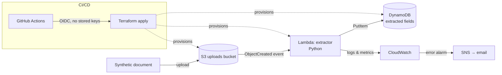

# Doc Intake Pipeline

Event-driven document intake pipeline on AWS. Documents land in S3, a Python Lambda extracts structured fields, and results are stored in DynamoDB. All infrastructure is provisioned with **Terraform** and deployed through **GitHub Actions CI/CD**.

> 🚧 **Status: active development.** v0.1 (core pipeline, IaC, CI/CD) is in progress. See the [roadmap](#roadmap) for what's built and what's next.
>
> All documents in this repo are **synthetic**. No real customer data is used.

---

## Architecture

### v0.1 (current)



### Target architecture

Upload API → S3 → Lambda → **LLM-based field extraction** → database → **containerized query API on ECS (Docker)**, inside a VPC with public/private subnets.

---

## Tech stack

| Area | Tools |
|---|---|
| Cloud | AWS (S3, Lambda, DynamoDB, IAM, CloudWatch, SNS) |
| Infrastructure as Code | Terraform (remote state in S3) |
| CI/CD | GitHub Actions with OIDC federation to AWS |
| Application | Python, pytest |
| Region | `us-east-2` |

---

## Roadmap

**v0.1: Core pipeline**
- [ ] Terraform remote state (S3 backend)
- [ ] S3 uploads bucket (encrypted, versioned, public access blocked)
- [ ] DynamoDB results table
- [ ] Lambda extractor triggered by S3 events
- [ ] Least-privilege IAM role for the Lambda
- [ ] GitHub Actions: tests + `terraform plan` on PRs, `terraform apply` on merge to `main`
- [ ] CloudWatch error alarm → email notification

**v0.2: AI extraction**
- [ ] PDF support
- [ ] LLM-based structured field extraction
- [ ] API key stored in AWS Secrets Manager

**v0.3: Query API**
- [ ] FastAPI service containerized with Docker
- [ ] Deployed on ECS Fargate in a VPC (public/private subnets)
- [ ] CloudWatch dashboard

**v0.4: Polish**
- [ ] Runbook and post-mortem
- [ ] Demo video
- [ ] RAG component over extracted documents

---

## Repository structure

```
infra/bootstrap/    # Terraform state bucket (one-time setup)
infra/              # Main Terraform configuration
src/extractor/      # Lambda source code
tests/              # Unit tests
samples/            # Synthetic test documents
.github/workflows/  # CI/CD pipelines
```

---

## Design decisions

- **DynamoDB over RDS (v0.1):** serverless, pay-per-request, and needs no VPC. That keeps the first version close to $0 to run.
- **OIDC over access keys:** GitHub Actions assumes an AWS role with short-lived credentials, so no long-lived secrets are stored in the repo.
- **S3 events over polling:** processing starts the moment a document lands, with no idle compute.

## Cost

v0.1 runs on serverless, pay-per-use services and is expected to cost cents per month. A budget alert is configured on the account. Later versions add hourly-billed resources (NAT gateway, load balancer), which will be torn down with `terraform destroy` when not demoing.

---

## Getting started

_Coming with v0.1._
